 

**A sleep-sounds mixer for Android: rain, ocean, fire and white noise, blended your way.**

> **Showcase repository.** This page presents the product and the engineering behind it. The source code is private.

---

## Brand

## What it does

| | |
|---|---|
| **Sound mixer** | Blend up to three sounds and set each volume on its own |
| **Sleep timer** | 15 to 90 minutes, with a gentle fade-out |
| **Saved mixes** | Keep favourite combinations and load them with one tap |
| **Sound library** | Rain, nature, white noise and focus sounds |
| **Background play** | Keeps playing with the screen off or while using other apps |
| **Premium** | Subscription removes ads |

## Engineering

| Area | Approach |
|---|---|
| App | Kotlin, Jetpack Compose, Hilt, Room |
| Audio | Media3 with background playback and fade transitions |
| Backend | Firebase |
| Monetisation | Google Play Billing subscription and ad mediation |
| Release | Play Store listing, privacy policy and staged release notes kept with the project |

## Design language

<table>
<tr>
<td bgcolor="#0A0E1A" width="110" align="center"><b>#0A0E1A</b> midnight</td>
<td bgcolor="#1A1F36" width="110" align="center"><b>#1A1F36</b> surface</td>
<td bgcolor="#6C8EF5" width="110" align="center"><b>#6C8EF5</b> soft blue</td>
<td bgcolor="#8B6CF5" width="110" align="center"><b>#8B6CF5</b> lavender</td>
<td bgcolor="#5DCAA5" width="110" align="center"><b>#5DCAA5</b> calm teal</td>
<td bgcolor="#E8A598" width="110" align="center"><b>#E8A598</b> warm peach</td>
</tr>
</table>

A dark, low-glare interface made for bedtime: deep midnight canvas, never pure white text, and accent colours used sparingly, with teal for nature and peach only for fire.

---

Built by [@ivaylozhivkov88](https://github.com/ivaylozhivkov88)

